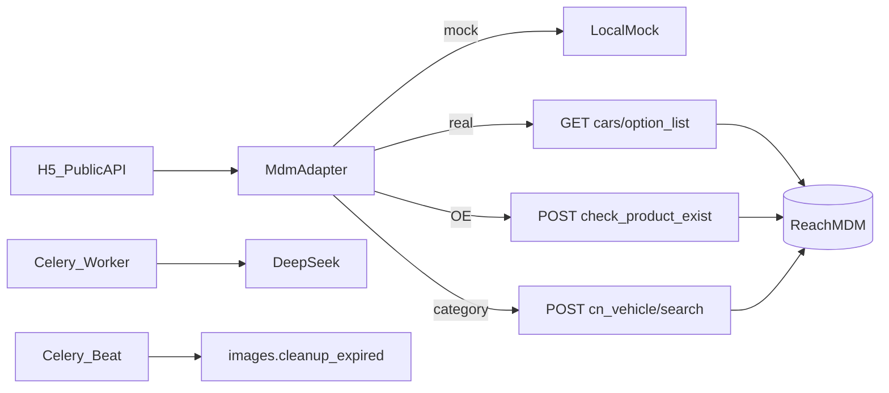

# 下一阶段全面推进计划

## 前提与决策

- 范围：**全部**待办（`mdm-real` / `celery-ops` / `ux-polish` / `retention-security` / `eval-loop`）。
- MDM：**不依赖外部 OpenAPI 文档**，按同级 `[/Users/litongxue/WorkCode/Reach/mdm](/Users/litongxue/WorkCode/Reach/mdm)` 只读 manage 接口改写适配器；默认仍可用 Mock，联调通过后再关 `MDM_USE_MOCK`。
- 对外契约不变：H5/Admin 仍消费 `VehicleOption` / `ProductItem`；编排逻辑收敛在 `[backend/app/integrations/mdm/client.py](backend/app/integrations/mdm/client.py)`。
- 明确不做：Docker、MongoDB、自研视觉模型、微信小程序。

## 1. 真实 MDM 适配（`mdm-real`）

重写 `[backend/app/integrations/mdm/client.py](backend/app/integrations/mdm/client.py)`：

| 现假设                        | 改为                                             |
| -------------------------- | ---------------------------------------------- |
| `Authorization: Bearer`    | 请求头 `**token: <MDM_API_TOKEN>**`（与 MDM Web 一致） |
| `GET /api/cars/brands      | series                                         |
| `GET /api/products/search` | 编排见下                                           |

**产品检索优先级（写死）：**

1. 有 OE → `POST /api/manage/products/check_product_exist`（body `reference.oe`），映射 `Materiel_Number`→`sku`、`part_name`→`name`，`match_reason=OE精确匹配`。
2. 无 OE 有品类 → `POST /api/manage/cn_vehicle/search`（`vehicle_type=passenger` 默认，可用 env 覆盖；`category_name` + 可选车型上下文），映射 `reach_number`→`sku`，`match_reason=品类匹配`。
3. 仍空 → 返回空列表（不静默回 Mock）；日志记录上游 `code/msg`。

**配置：** 扩展 `[backend/app/core/config.py](backend/app/core/config.py)` / `.env.example`：`MDM_API_BASE_URL`、`MDM_API_TOKEN`、`MDM_USE_MOCK`、`MDM_VEHICLE_TYPE=passenger`、可选 `MDM_COUNTRY`（若 cascade 需国家过滤）。文档注明需 MDM 服务账号具备上述 path 的 RBAC。

**测试：** 在 `[backend/tests/test_integrations.py](backend/tests/test_integrations.py)` 用 `httpx.MockTransport` 覆盖 option_list / check_product_exist / cn_vehicle 三种映射；保留现有 mock 搜索用例。

## 2. Celery 运维（`celery-ops`）

改 `[backend/app/tasks/celery_app.py](backend/app/tasks/celery_app.py)` + `[dispatcher.py](backend/app/tasks/dispatcher.py)` + `[scripts/start_dev.sh](scripts/start_dev.sh)`：

- `beat_schedule`：每日调度 `images.cleanup_expired`（如 `crontab(hour=3, minute=0)`）。
- `run_vision_task`：可重试异常走 `self.retry(countdown=10)`，用满 `max_retries=1`；业务失败写 `session.error_message` 后不再无限重试。
- `GET /health` 扩展或新增 `GET /ready`：探测 DB（已有）、Redis ping、`celery_workers_available()`；Celery 关闭时标记 `celery=disabled` 而非失败。
- Admin `POST .../sessions/{id}/retry` 改为走 `dispatch_vision_recognition`；列表露出 `task_id` / `error_message`。
- `start_dev.sh`：启动 worker + **beat**；启动后 ping worker，失败则 stderr 告警；`stop_dev.sh` 一并停 beat。

## 3. H5 体验（`ux-polish`）

聚焦 `[frontend-h5/src/views/HomeView.vue](frontend-h5/src/views/HomeView.vue)`、`[ResultView.vue](frontend-h5/src/views/ResultView.vue)`、`[stores/recognition.js](frontend-h5/src/stores/recognition.js)`：

- **进度阶段**：用后端已有 `session.status`（`created|uploading|processing|done|failed`）驱动 `van-steps` + 轮询文案（排队中 / 识别中 / 失败可重试）；弱网超时给出明确失败态与「重新识别」。
- **多角度引导**：上传槽位固定 3–4 类（整体 / 接口 / 铭牌 / 其他），写入已有 `purpose` + `sort_order`；槽位文案+Emoji，不再只靠一句 tip。
- **OE OCR**：展示 API 已返回的候选与置信度；未确认 OE 前禁止进入产品查询（已有 confirm 接口，UI 强制）。
- **结果可解释**：产品页强化 `match_reason` 展示（适配器合成字段）。

后端仅在必要时补：`serialize_session` 增加轻量 `progress_hint`（可选），避免大改协议。

## 4. 留存与安全（`retention-security`）

策略（写死）：

- 所有原图默认 `expires_at = now + IMAGE_RETENTION_DAYS`（30）。
- `optimization_consent=true` 仅表示**允许用于评测/优化导出**，不延长物理留存；撤回后不得再进评测集。
- Beat 真正跑通现有 `[cleanup_expired_images_task](backend/app/tasks/celery_app.py)`；清理写审计 `images.cleanup`（批量摘要即可）。

实现：

- Public：`POST /api/v1/public/recognize/{id}/consent` 与 `.../consent/revoke`（或统一 PATCH），更新 `optimization_consent` / `_at`，审计 `session.consent_*`。
- H5：授权勾选走真实 API（去掉仅 localStorage）；提供撤回入口。
- 复核：敏感日志不打印完整 API Key / MDM token；上传限流保持 device Redis 限流，文档说明 Redis 宕机 fail-open。

## 5. 评测闭环（`eval-loop`）

不建重型标注平台，用已有确认数据：

- **软金标**：`confirmed_category_code` 非空的会话；若 `feedback_correct=False` 记为负例样本池。
- **指标**：对 `RecognitionResult`：Top-1 = mapped/首候选 == 确认码；Top-3 = 确认码 ∈ candidates 前三；拒识率 = confidence < 阈值（config `EVAL_REJECT_CONFIDENCE`，默认 0.45）且用户未确认成功。
- Admin：扩展 `[GET /api/v1/admin/stats](backend/app/api/v1/admin/manage.py)` + `[DashboardView.vue](frontend-admin/src/views/DashboardView.vue)` 展示 Top-1 / Top-3 / 拒识率 / 反馈正确率；会话列表可筛 `feedback_correct=false`。
- 脚本：`scripts/export_eval_errors.py` 导出错误样本（session id、确认类、模型类、candidates、是否授权）供人工复盘；仅导出 `optimization_consent=true` 的图引用。

## 实施顺序

1. Celery beat + `/ready` + vision retry + 脚本启停（解锁清图）
2. MDM 适配重写 + MockTransport 测试（可先 `MDM_USE_MOCK=true` 合入）
3. Retention consent API + cleanup 审计
4. H5 进度 / 多角度 / OE / match_reason
5. Eval stats + 导出脚本 + Admin 看板

## 验收标准

- `MDM_USE_MOCK=false` 且 token 有效时：车型四级联动与 OE/品类查品走真实 MDM，字段映射正确。
- `start_dev.sh` 后 `/ready` 显示 redis/celery ok；次日或手动触发 beat 可清过期图。
- H5 识别过程可见阶段；失败可重试；OE 未确认不能查品。
- Admin 看板可见 Top-1/Top-3；错误样本可导出且尊重授权。
- 现有 pytest 全绿，并新增 MDM 映射与 stats 计算用例。

