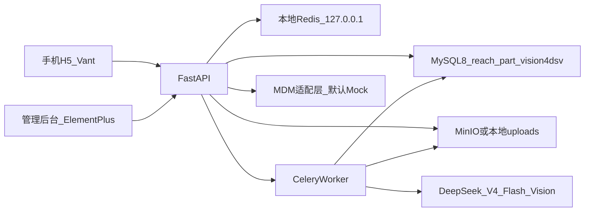

# 汽配零件视觉识别服务实施计划（更新版）

## 当前结论

首期 MVP **已实现并可本地跑通**：手机 H5 上传零件图 → Celery 异步调用 DeepSeek Vision → 品类确认 / 车型 / OE → 返回产品（当前 Mock）→ 管理后台可查记录与映射。

不引入 Docker、不引入 MongoDB/Beanie。业务库必须独立为 `reach_part_vision4dsv`。

## 实际架构



### 仓库结构

- [`backend/`](backend/)：FastAPI + Tortoise + Pydantic V2 + Celery + Redis + MinIO/本地存储
- [`frontend-h5/`](frontend-h5/)：Vue3 + Vant，移动优先 + Emoji
- [`frontend-admin/`](frontend-admin/)：Vue3 + Element Plus
- [`scripts/`](scripts/)：`start_dev.sh` / `stop_dev.sh` / `run_api.sh` / `run_worker.sh`

### 已落地关键能力

| 能力 | 状态 | 说明 |
|------|------|------|
| 匿名设备会话 | 已完成 | `X-Device-Token`，兼容无 `crypto.randomUUID` 环境 |
| 1–4 张零件图上传 | 已完成 | 压缩 JPEG、本地/MinIO 自动回退 |
| Celery 异步识别 | 已完成 | 默认推荐；无 worker 时可降级同步 |
| DeepSeek Vision | 已完成 | 参考 demo，配置全部进 `.env` |
| 品类映射 Top 候选 | 已完成 | alias → 标准品类 |
| 车型级联 / OE / 产品 | 已完成 | MDM Mock；待真实接口 |
| 铭牌 OE OCR 入口 | 已完成 | 需用户确认后再查 |
| 管理后台 | 已完成 | 概览、记录、映射、Prompt、用户、审计 |
| 日志 | 已完成 | 控制台 + `backend/logs/app.log` |
| 一键启停 | 已完成 | Redis 检查 + API + Celery + 可选 H5/Admin |

## 运行约定（踩坑后固化）

1. **Redis / Celery 必须用本地**
   - `REDIS_URL=redis://127.0.0.1:6379/0`
   - `CELERY_BROKER_URL=redis://127.0.0.1:6379/1`
   - `CELERY_RESULT_BACKEND=redis://127.0.0.1:6379/2`
   - 勿再指向 `192.168.5.235` 的 Celery Redis，否则任务无人消费或误连。

2. **推荐启动方式**
   ```bash
   ./scripts/start_dev.sh
   ./scripts/stop_dev.sh
   ```
   - API 后台模式不加 `--reload`，避免进程被父 shell 带走。
   - Worker 使用 `--without-heartbeat --without-mingle --without-gossip`，提高本地稳定性。

3. **常见错误对照**
   - **502**：多半是 API 进程已退出，Vite 代理网关失败 → 先 `./scripts/start_dev.sh`
   - **503**：`CELERY_ENABLED=true` 且无 worker → 启动 worker，或临时 `CELERY_ALLOW_INLINE_FALLBACK=true`
   - **识别一直 processing**：任务进了队列但无 worker → 检查本地 Celery
   - **`crypto.randomUUID is not a function`**：HTTP 局域网访问非安全上下文 → 已做兼容回退

4. **存储策略**
   - `STORAGE_BACKEND=auto`：优先 MinIO，不可用则回退 `backend/uploads/`
   - 原图策略仍按「默认保留 30 天；用于优化需用户勾选同意」推进落地清理任务

5. **密钥与库隔离**
   - DeepSeek / DB 密码只写 [`backend/.env`](backend/.env)
   - 禁止使用 `ReachMDM_LMR`；启动与建库脚本校验受保护库名

## 识别主链路（现状）

1. H5 创建设备会话 → 创建识别会话  
2. 上传 1–4 张图到对象存储  
3. `POST .../start` → 优先 Celery `recognition.run_vision`  
4. DeepSeek 返回 `part_name/confidence/reason/candidates` → 品类映射  
5. 用户确认品类，可选车型 / 手输 OE / 铭牌 OCR 确认  
6. MDM 适配层检索产品并展示匹配原因  
7. 用户反馈正确/错误，写入审计

## 下一阶段（优化重点）

### 1. 真实 MDM 联调（优先）

- 用正式 OpenAPI/示例替换 Mock
- 对齐字段：物料号、OE、适配车型、图片、库存、价格
- `MDM_USE_MOCK=false` 后做回归

### 2. Celery 运维加固

- `start_dev.sh` 启动后自动 ping worker；失败即告警
- 管理端展示任务 ID / 失败原因 / 一键重试
- 可选简单进程守护（worker 挂掉自动拉起）

### 3. 识别质量闭环

- 准备覆盖主品类、多角度、光照差异的评测集
- 统计 Top-1、Top-3、低置信度拒识率、产品召回
- 管理端错误样本筛选与 Prompt 版本对比

### 4. H5 体验打磨

- 长耗时识别进度与阶段文案（上传中 / 排队中 / 识别中）
- 多角度拍摄引导更强
- 结果排序可解释（OE 精确 > 车型适配 > 品类）

### 5. 留存与安全收尾

- Celery 定时清理过期原图（已有任务骨架，需挂 beat）
- 优化授权撤回与审计
- 复核限流、日志脱敏、CORS 生产配置

## 明确不做（除非新需求）

- Docker / Compose（当前阶段）
- MongoDB / Beanie
- 自训练视觉模型 / 向量库
- 微信小程序（当前为手机浏览器 H5）

## 验收清单（持续）

- [x] 独立库 `reach_part_vision4dsv` 创建与保护库校验
- [x] DeepSeek 配置化调用（无硬编码 key）
- [x] H5 主链路可演示（Mock 产品）
- [x] 管理端可登录并查看记录/映射
- [x] 本地 Redis + Celery 异步识别
- [x] 一键启停与日志
- [ ] 真实 MDM 字段联调通过
- [ ] 评测集与准确率基线
- [ ] 原图 30 天自动清理上线
- [ ] 生产反向代理 / HTTPS 方案
